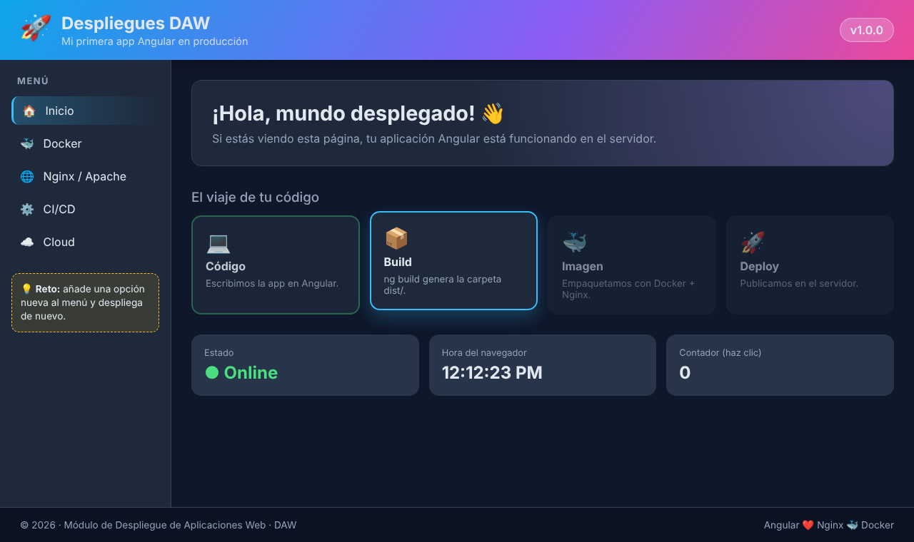

# 🚀 Despliegues DAW · Angular Demo

Proyecto Angular muy sencillo para practicar **despliegue de aplicaciones web** en el módulo de DAW.

La página tiene 4 componentes:

| Componente | Ruta | Qué muestra |
|---|---|---|
| `Header` | `src/app/components/header` | Cabecera con degradado y la **versión** de la app |
| `Aside`  | `src/app/components/aside`  | Menú lateral interactivo |
| `Main`   | `src/app/components/main`   | Pipeline animado (Código → Build → Imagen → Deploy), reloj y contador |
| `Footer` | `src/app/components/footer` | Pie de página |



## ▶️ Ejecutar en local

Requisitos: Node.js 20.19+ o 22+.

```bash
npm install
npm start          # http://localhost:4200
```

## 📦 Generar la build de producción

```bash
npm run build
```

Los ficheros estáticos quedan en `dist/despliegues-angular-demo/browser/`. Esa carpeta es la que hay que subir a cualquier servidor web (Apache, Nginx, GitHub Pages, Netlify…).

## 🐳 Desplegar con Docker + Nginx

```bash
docker build -t angular-demo .
docker run -d -p 8080:80 --name angular-demo angular-demo
# Abrir http://localhost:8080
```

## 🧪 Ideas de práctica

1. Cambia `version` en `src/app/components/header/header.ts`, vuelve a desplegar y comprueba que aparece la nueva versión.
2. Despliega la carpeta `dist/` en un **Apache** y en un **Nginx** sin Docker. ¿Qué pasa si no configuras `try_files`?
3. Publica la app en **GitHub Pages** (`ng build --base-href /<repo>/`).
4. Crea un workflow de **GitHub Actions** que haga `npm ci && npm run build` en cada push.
5. Sube la imagen Docker a **Docker Hub** y despliégala en otra máquina.
